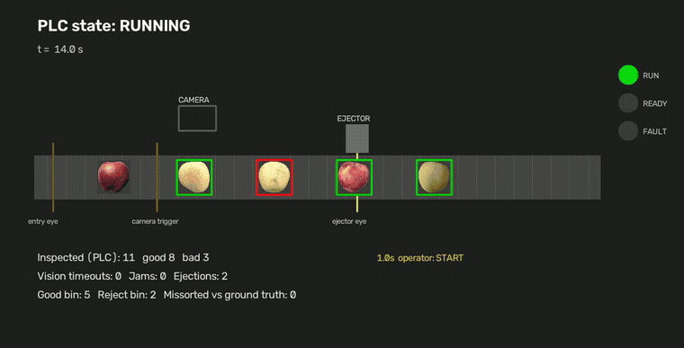

# Smart sorting line: PLC + machine vision + part tracking

A conveyor sorting line where a **real PLC runtime (OpenPLC, IEC 61131-3 Structured Text)** controls the belt, triggers a camera, tracks every part with an encoder and fires a reject ejector. The vision station runs my [apple quality classifier](https://github.com/ilyessaadna10/apple-quality-classifier). The PLC talks to the line over **Modbus TCP remote I/O**, the same way it would talk to a WAGO or ET200 rack on a real machine.

The plant is simulated in Python. The control program is not: it is compiled by OpenPLC's IEC compiler and runs in the OpenPLC runtime with a 10 ms scan.



Full 90 s run with E-stop, jam and camera failure: [results/line_demo.mp4](results/line_demo.mp4)

## Architecture

```
              OpenPLC runtime  (plc/sorting_line.st, 10 ms task)
              ├── Modbus TCP master, polls remote I/O every 20 ms
              │      %IX100.0 .. %IX101.1   push buttons, E-stop chain, photo-eyes, camera result
              │      %IW100                 encoder counter (belt pitches)
              │      %QX100.0 .. %QX100.5   conveyor, camera trigger, ejector, stack lamp
              └── Modbus TCP server :5502   status words %MW0..%MW6 for the HMI

  sim/line.py     plant: belt, apples, photo-eyes, encoder, ejector, camera station, remote I/O (:5020)
  sim/run_line.py runs a test scenario, draws the HMI, records the video, writes the FAT report
```

| PLC function | How it is done |
|---|---|
| State machine | IDLE, RUNNING, STOPPED, E-STOP, JAM. Stack lamp: green run, amber ready, red fault |
| Safety | E-stop chain is normally closed and always wins. Restart needs a healthy chain **and** RESET |
| Vision handshake | Photo-eye edge fires the trigger; result latched on DONE; **400 ms timeout rejects the part** (fail-safe) |
| Part tracking | Shift register clocked by the encoder count, verdict stored at the camera slot, ejector fires 3 pitches later |
| Jam detection | Entry or ejector eye blocked for 3 s while the belt runs stops the line |
| HMI data | Good, bad, total, vision timeouts, jams and ejections as Modbus holding registers |

## Simulated factory acceptance test

The test script presses the buttons and injects faults while the PLC runs. Results from [results/fat_report.md](results/fat_report.md):

| Check | Result | Detail |
|---|---|---|
| I/O loss at power up is treated as E-stop, cleared only by RESET | PASS | PLC held E-stop until RESET |
| E-stop stops the belt | PASS | belt off after 30 ms |
| No restart without RESET after E-stop | PASS | belt stays off until reset |
| Jam detected and belt stopped | PASS | jam state after 2.9 s |
| Camera failure: parts rejected fail-safe | PASS | 6 parts rejected on timeout |
| Every inspected apple routed as the camera decided | PASS | 58/58 |

Camera latency from trigger to result: p50 91 ms, p95 104 ms on a laptop CPU (budget 400 ms).

The sorting numbers show that the **control system** does what the camera says. They do not measure the classifier: the demo draws apples from the whole dataset, which the model has partly seen in training. The classifier's honest accuracy is its out-of-fold result: **97.6 %** on 415 photos, 98.3 % of bad apples caught.

## Bugs I found while commissioning (and what they taught me)

1. **The line came up in E-stop.** Before the remote I/O connected, the PLC read the E-stop input as 0. That is correct fail-safe behaviour, so I kept it and made it an acceptance test: the operator has to press RESET after power up.
2. **The line stayed in JAM forever.** My first reset logic only accepted RESET when both photo-eyes were clear, but on a stopped belt an apple can legitimately sit under an eye. Now RESET clears the fault, and if the jam is really still there, the 3 s timer trips again as soon as the belt runs.
3. **Every apple was rejected.** The camera took 2.4 s per apple because every inspection started a new thread and paid the model warm-up again. A persistent camera worker that warms up at boot brought it to about 90 ms. The PLC's 400 ms timeout had rejected those parts safely, which is exactly what it is there for.
4. **A few apples went to the wrong bin, randomly.** The encoder was wired as a 60 ms pulse on a polled input. When the CPU was busy, a Modbus poll sometimes missed a pulse, and one missed pulse shifts every tracked part by one slot. I moved the encoder to a counter register (like a counter module on a real rack) and the PLC now shifts by the count difference. Every full run since then has routed every inspected apple as the camera decided (57/57, 57/57, 56/56, 58/58).

## Run it

Needs Linux, Python 3 with `pymodbus==3.8.6 opencv-python numpy torch timm`, and the classifier models from the [apple-quality-classifier release](https://github.com/ilyessaadna10/apple-quality-classifier/releases).

```bash
# 1. build OpenPLC v3 once (https://github.com/thiagoralves/OpenPLC_v3), then load this program and its I/O map
./plc/setup_openplc.sh /path/to/OpenPLC_v3
/path/to/OpenPLC_v3/start_openplc.sh          # web UI on http://localhost:8080

# 2. run the line, the scenario and the HMI recording
python sim/run_line.py --models /path/to/models --images /path/to/apple_images --plc-port 5502 --show
```

## Limitations

- The plant, sensors and timing are simulated; there is no real conveyor or pneumatics.
- No safety PLC: on a real machine the E-stop would be a hardwired safety relay or a safety PLC (PLd/SIL2), and the standard PLC would only monitor it.
- The HMI is drawn with OpenCV. On a real line it would be a SCADA or panel screen reading the same Modbus registers.

**Author:** Saadna Ilyes, final-year Industrial Networks & AI engineering student · [GitHub](https://github.com/ilyessaadna10) · [LinkedIn](https://linkedin.com/in/ilyes-saadna) · ilyessaadna4@gmail.com
